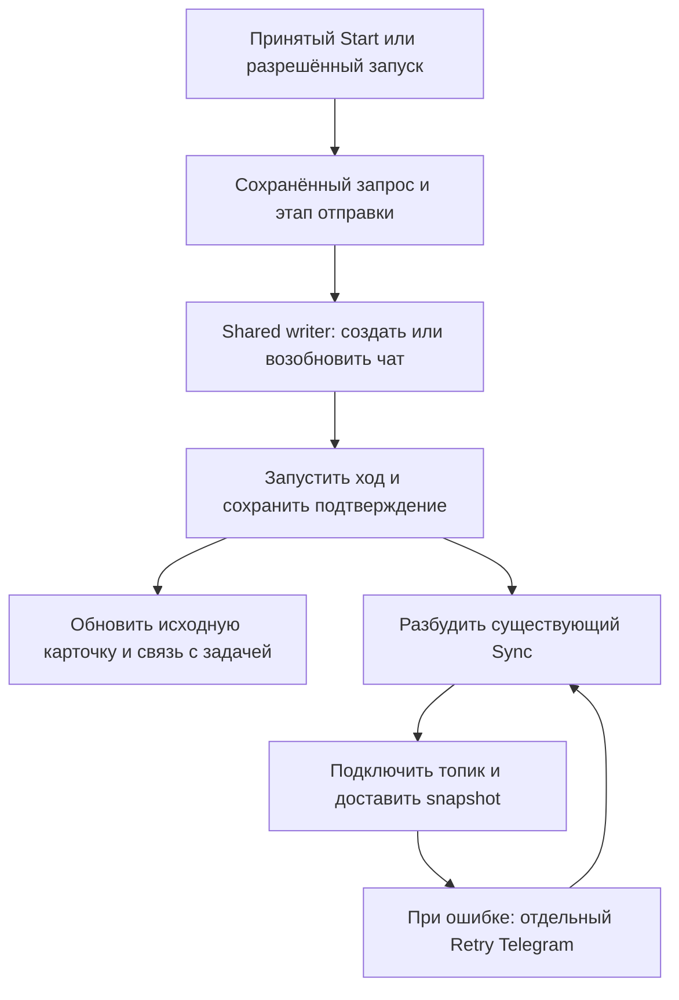

# План независимого запуска Codex и восстановления Telegram

Статус: технический план от 2026-11-09 реализован в рабочем diff;
[результаты проверки](external-launch-independent-of-telegram-validation.md).
Основание: [спецификация](external-launch-independent-of-telegram-spec.md)
и [проверка требований](external-launch-independent-of-telegram-spec-review.md).
Рабочий демон этим изменением пока не обновлялся.

## Решение

Внешний запрос запускает Codex непосредственно через существующий shared writer.
`external_launch_requests` хранит этап отправки и подтверждённые thread/turn ID.
После этого обычный Sync подключает Telegram к известному чату. Telegram receipt
больше не является квитанцией выполнения внешнего запроса.

Используем существующие циклы, SQLite, writer manager, очередь Sync-доставки,
сопоставление событий создания и уведомления. Новые сервисы, универсальная
очередь заданий и второй механизм запуска не нужны.

| Вариант | Оценка |
| --- | --- |
| Перехватить ошибку создания топика и продолжить старый draft-путь | Не подходит: draft и receipt требуют topic/message ID; остаются ожидание Telegram и зависимость восстановления от него. |
| Запускать Codex напрямую, затем использовать обычный Sync | Выбран: один источник выполнения и существующий механизм отображения; требует явного этапа отправки в запросе. |
| Добавить отдельные очереди и обработчики для выполнения и отображения | Не требуется: в демоне уже есть запуск внешних запросов, периодический producer и Sync delivery workers. |

## Данные и границы ответственности

Добавляем поля через существующие идемпотентные `ensureColumn`-миграции.
Новых таблиц не вводим.

| Место | Изменение | Назначение |
| --- | --- | --- |
| `external_launch_requests` | `dispatch_phase` | Отличать достоверно неотправленный этап от потенциально отправленного RPC без Telegram receipt. |
| `external_launch_requests` | `telegram_rendered_fp` | Перерисовывать карточку при изменении проблемы Telegram или кнопок, даже если execution status прежний. |
| `sync_topic_creations` | nullable `supersedes_id` и уникальный индекс для непустого значения | Хранить ручные повторы цепочкой, не переписывая неизвестный исход предыдущей попытки. |
| `sync_topics` | `delivery_error`, `delivery_revision` | Сохранять ошибку доставки в известный топик и принимать один Retry этой версии проблемы. |

Статус внешнего запроса и `error_type/error_summary` описывают выполнение Codex.
Telegram-состояние карточки вычисляется по текущей Sync-сессии, привязке,
головной попытке создания и ошибке доставки. Отдельное копируемое состояние
Telegram на каждом запросе не хранится. `TelegramTopicID/TelegramMessageID`
запроса по-прежнему указывают на исходную карточку в Requests, а не на топик чата.

`telegram_rendered_status` сохраняется для существующей проверки видимости
автоматического запуска. Новый fingerprint включает статус, thread/turn ID,
состояние отображения, актуальную ошибку и версию действия; часы не включаются.
Он записывается только после успешного редактирования соответствующей версии.

Предлагаемые значения `dispatch_phase`:

| Фаза | Что доказано | Восстановление после остановки демона |
| --- | --- | --- |
| `not_sent` | Мутация Codex ещё не допущена к отправке | Retry запуска с исходными настройками. |
| `thread_sending` | `thread/start` мог быть отправлен, подтверждения нет | Outcome unknown; новый чат не создавать. |
| `thread_ready` | Thread ID сохранён; первый `turn/start` не отправлен | Retry первого хода в этом чате после проверки, что чат свободен. |
| `turn_sending` | `turn/start` мог быть отправлен, подтверждения нет | Проверка состояния без повтора команды. |
| `turn_confirmed` | Сохранены thread ID и точный turn ID | Завершить локальную фиксацию/сверить результат, не отправляя новый ход. |
| пустая | Историческая запись без новой квитанции | Разбор совместимости; никогда не считать её автоматически `not_sent`. |

Фаза меняется условным обновлением по запросу, статусу и предыдущей фазе.
Известный отказ RPC возвращает фазу к последнему доказанному безопасному этапу;
сетевой обрыв и остановка после записи `*_sending` этого не делают.

## Запуск и наблюдение за Codex

1. Сохранить действующие admission-проверки Start и auto-start. После claim
   поставить dispatch в работу **до** редактирования карточки. Сейчас
   `processExternalLaunchRequests` сначала выполняет render и только потом
   dispatch — этот скрытый барьер также убрать.
2. В `external_dispatch.go` заменить создание внешнего topic draft на прямой
   запуск. Новый чат использует `ReserveProcess` → `ThreadStart` → `ClaimThread`;
   продолжение сохраняет `Reserve`, `ThreadResume` и повторную проверку idle.
   Для нового внешнего запроса не создавать фиктивный Sync receipt с нулевыми ID.
   `/newchat` и обычные входящие сообщения продолжают использовать свои drafts/receipts.
3. В существующем `BeforeSend` из `sync_rpc.go` перед мутацией атомарно сохранить
   `thread_sending` или `turn_sending`. Ошибка этой записи запрещает RPC.
   Сохранить порядок `syncMu` → `taskLaunchMu` и освобождение обоих замков
   на время ожидания ответа App Server.
4. После ответа `thread/start` сначала сохранить thread ID и `thread_ready`,
   затем связать задачу с чатом существующим `bindExternalTaskThreadTx`.
   При ошибке сохранения/привязки первый ход не отправлять. После ответа
   `turn/start` сначала сохранить точный результат как `turn_confirmed`,
   затем завершить существующий переход в `session_started`. Ошибка последующей
   локальной фиксации восстанавливается по этой записи без нового RPC.
5. Для продолжений тоже сохранять thread ID до `turn/start`, а подтверждённый
   turn — до дальнейшей обработки. `RetryExternalLaunchRequest` перестаёт
   безусловно очищать известные thread/turn ID. Созданный чат используется повторно;
   неизвестная отправка не становится retryable только из-за отсутствия ID.
6. После допуска запуска убрать проверки наличия `forum`, успешной Telegram-записи
   и повторного сетевого подтверждения Telegram из execution-пути. Проверять
   сохранённые session/group/security, отмену запроса, состояние shared writer
   и явный off. Известная недействительность доступа по-прежнему запрещает запуск;
   временное ожидание Telegram-проекции не является новым условием принятого запуска.
7. Использовать уже сохранённые prompt/options; после подтверждения сохранить связь с задачей,
   разбудить renderer и Sync. Начальное `[User]` доставляет обычный snapshot catch-up,
   а не синхронная отправка перед запуском. Для терминальной защиты использовать
   имеющийся `markTelegramOriginTurn(thread, turn)`, которому topic ID не нужен.
   После перезапуска восстановить этот marker по подтверждённому запросу
   до обработки его terminal snapshot.

Обобщить `boardContinuationLeases` до владения внешними запусками: тот же
точный `(request, thread, turn, writer generation)` обслуживает и новый чат,
и продолжение. Не создавать параллельный lease manager.

В `board_snapshot.go` и event-routing наблюдать объединение связанных задач
и незавершённых внешних запросов с известным thread ID, включая запросы без task ID.
Наличие топика и доступность Telegram не определяют, читается ли состояние Codex.
Фоновый обход выполнения должен идти до потенциально медленной Telegram-части.

Для обоих путей snapshot сначала проходит terminal gate и сохраняется;
затем фиксируется terminal запроса, выполняется возврат polling-задачи в Inbox
и освобождается соответствующий writer. Старый terminal при неизвестной отправке
не является доказательством завершения. Если запись snapshot/terminal не удалась,
владение сохраняется для повторной локальной фиксации. Рабочие approval/input
остаются в Codex, пока Telegram недоступен.

Проверить и устранить удержание execution-замков на Telegram IO в затронутых
путях (`sync_recovery.go`, обновление устаревших action cards, lifecycle/control).
Использовать существующий образец: взять данные и версию под замком, выполнить
IO без него, повторно проверить session/route перед применением результата.
Новый глобальный замок или отдельный диспетчер для этого не нужен.

## Один механизм подключения топика

После получения thread ID все новые попытки используют каноническую цель
`thread:<id>`. Discovery и ручное восстановление вызывают один store-helper
подготовки попытки и один путь её подтверждения. Не оставлять отдельные
новые `external:<request>`-операции рядом с `thread:<id>`.

Использовать существующие `syncDeliveryJobs` для ручного восстановления:
`runSyncDelivery` при отсутствии топика сначала обеспечивает его привязку,
затем доставляет сохранённый snapshot. Discovery может вызывать тот же helper
своим текущим путём; право выполнить remote create получает только обработчик,
который создал новую durable-попытку. Второй обработчик видит её `sending`
и не вызывает Telegram. Очередь — только сигнал; намерение уже находится в SQLite.

Правила store-helper:

- При действующей привязке вернуть её, не создавая топик.
- При головной `sending/unknown` не делать автоматическую попытку. При известном
  ID повторить только локальную materialization. Исход попытки сохранять отдельно
  от наличия действующего маршрута.
- Ручной Retry сначала выполняет существующее однозначное восстановление.
  Если результата нет, одной транзакцией потребляет актуальный callback
  и создаёт преемника головной попытки с `supersedes_id`. Даже если два запроса
  относятся к одному чату, у одной головной попытки может быть только один преемник.
- Не изменять `unknown` на `failed` и не переименовывать target старой операции
  ради снятия запрета. Все неизвестные предшественники остаются участниками
  существующей проверки неоднозначных имён.
- `sending` после перезапуска становится `unknown`, а не разрешением отправить
  запрос снова. Повтор creation требует нового явного Retry.

В `MaterializeTopicCreation` проверить существующую привязку **в той же
транзакции**, что вставляет новую. Тот же topic ID даёт идемпотентный успех;
другой ID сохраняется как подтверждение отдельной попытки и вызывает уведомление,
но не создаёт второй маршрут. Позднее событие без однозначного соответствия
не связывается по одному имени. Сохраняются проверки собственного бота,
точной группы, legacy fence и правила позднего подтверждения после off.

При подключении топика отразить в его `active_turn_id/state/writer_generation`
текущее внешнее владение без создания искусственного входящего receipt.
Это проекция тех же координат, необходимых существующим steering, `/stop`
и approval/input callbacks. До подтверждения turn состояние starting/unknown
не допускает новый пользовательский запуск; после подтверждения используется
тот же writer lease. Закрытие топика не удаляет execution-запись.
После terminal обновить эту проекцию перед освобождением writer; два пути
наблюдения не освобождают один lease независимо друг от друга.
Проверить управление из топика, появившегося уже во время внешнего хода,
и сохранение возможности ответить на pending request в Codex.

## Карточка и Retry

На карточке раздельно показывать `Codex: Started/Completed/Failed/Unknown`
и `Telegram: pending/connected/error/unknown/off`, со ссылкой на известный чат.
Это вычисляемое представление, а не новая комбинационная машина статусов.

`externalLaunchActions` выбирает действия по двум независимым исходам:

- доказанно неотправленный execution-этап → **Retry** запуска;
- подтверждённо начатая или завершённая работа и ошибка Telegram → **Retry** Telegram;
- неизвестная Codex-отправка → **Check status**, без повторной отправки;
  при известном чате и отдельной ошибке Telegram также доступен **Retry** Telegram;
- устранённая проблема или off → устаревший Retry не выполняет IO.

При Retry запуска после известного отказа Telegram восстанавливается обычным
независимым путём; вторую одноимённую кнопку рядом не показывать. Пояснение
на карточке различает повтор запуска и повтор отображения. Успешному запуску
из-за ошибки Telegram не добавлять execution-действие Close/Dismiss.

У кнопки есть собственное action-имя и сохранённые координаты: request, thread,
Sync session и ожидаемая головная попытка либо topic/delivery revision.
Одна транзакция проверяет актуальность и потребляет callback. Retry Telegram
не вызывает `dispatchExternalLaunchRequest`, не меняет execution status,
не создаёт polling event и не переводит задачу между колонками.

При ошибке доставки в уже известный топик `deliverSyncSnapshot` возвращает
агрегированный результат, сохраняя существующий порядок User/Status/Final
и частичные delivery fingerprints. `delivery_error` очищается только при
успешной доставке актуального требуемого содержимого. Ошибки разных частей
не маскируются успешным редактированием одной Status-карточки.

Retry известного топика условно увеличивает `delivery_revision`, убирает
ошибку из состояния готового к нажатию действия и ставит существующий delivery job.
Ошибка новой попытки возвращает новый актуальный Retry; повтор прежнего callback
ничего не добавляет. Завершённый Codex-запрос также остаётся доступным для
Telegram-восстановления. Изменения проблемы будят renderer исходной карточки;
непрошедшая доставка не считается отрисованной.

При обновлении `/requests` и выборки карточек учитывать незакрытые проблемы
Telegram у завершённых запусков. Не отправлять отдельную карточку на каждую
ошибку. Существующие Control-уведомления сохраняют дедупликацию и закрытие
эпизода; сообщают о неизвестном исходе, возможном лишнем топике и обнаруженном дубле.

## Совместимость и перезапуск

- Миграция добавляет поля без очистки истории и не запускает работу.
  Старые подтверждённые turn ID остаются авторитетными; известные receipt routes
  читаются для восстановления исторических запросов до их нормализации.
- Старые `telegram_topic`/`telegram_prompt` можно признать неотправленными только
  по доказанной pre-dispatch ветке прежнего кода и при отсутствии противоречащего
  receipt/turn. Дать Retry, не включать автоматический запуск миграцией.
  Другие пустые ID не являются основанием для `not_sent`.
- Исторические `external:<request>` и их сохранённые попытки не теряются.
  После установления thread ID общий helper учитывает их как aliases этого чата
  через связь с запросом, до любой новой `thread:<id>`-попытки. Подтверждённый
  legacy draft присоединяется к уже созданному чату, а не запускает его повторно;
  неизвестный legacy create блокирует фоновое создание и допускает только Retry.
- `ResumeConfirmedTopicLaunches` больше не запускает Codex в ответ на подтверждение
  Telegram. Его роль заменяется восстановлением отображения; прежний receipt fallback
  остаётся только для чтения старой истории. Удалить новый внешний draft-путь
  и недостижимые ветки после подключения совместимости.
- Для `not_sent/thread_ready` после рестарта показать Retry; `*_sending` оставить
  unknown. Для `turn_confirmed` завершить только локальную фиксацию. Проверка
  неизвестного запуска не принимает произвольный latest turn за искомый.
- Отмена задач и их переносы учитывают фазу отправки. Команду с `*_sending`
  нельзя признать неотправленной по пустому thread ID; созданный чат сохраняется,
  даже если ещё не отправленный первый ход отменён. Off не обнуляет execution state.
- При обновлении инвалидировать fingerprints карточек. Старый исполняемый файл
  не умеет новый протокол восстановления: rollback выполняется только после
  остановки демона и проверки незавершённых фаз; вслепую запускать прежний бинарь
  на изменённых in-flight записях нельзя.

## Порядок реализации

Работать только в перечисленных подсистемах и документах. Уже имеющиеся
сторонние изменения cron/task cards/UI не включать в эту задачу.

1. **Независимый execution и наблюдение.** Сначала regression-тесты, затем
   `dispatch_phase`, безопасное сохранение ID, прямой новый запуск и продолжения,
   независимое наблюдение/terminal cleanup, устранение render-before-dispatch.
   Файлы: `internal/{model,storage}/` external request methods,
   `daemon/{external_dispatch,external_requests,sync_rpc,board_snapshot,sync_recovery}.go`
   и точечно маршрутизация snapshot/events в `sync.go`.
   Первый полезный результат: работа запускается и завершается без Telegram-топика.
   На этой стадии не переделывать обычные drafts или источник polling-событий.
   Коммит: `Decouple external Codex execution from Telegram delivery`.
2. **Восстановление Telegram.** Добавить цепочки попыток, общую цель thread,
   транзакционную привязку, ошибки доставки и версию Retry, fingerprint карточки,
   action и legacy aliases. Файлы: `storage/store_topic_creation.go`,
   `storage/store_sync.go`, external request queries, `daemon/topic_creation.go`,
   Sync creation/delivery и `external_requests.go`. Тесты писать перед изменением
   поведения; UI task board не расширять.
   Коммит: `Add durable Telegram retry to external launch cards`.
3. **Закрыть совместимость и контракт.** Проверить старую БД, обновить
   ADR-029/036, contract matrix и regression map; убрать заменённые внешние
   drafts/resume-ветки, сохранить чтение legacy receipts. Провести полный прогон
   и свежую проверку кода по правилам проекта. Затем подготовить live QA
   и установку только в рамках отдельного запроса на выкладку.
   Коммит: `Document and validate external launch recovery compatibility`.

Каждый шаг зависит от предыдущего; промежуточные коммиты не объявляются
полной реализацией спецификации. Запуск новых тестовых задач и изменение
рабочего демона в подготовку этого плана не входят.

## Проверка результата

| Требование | Проверка, отличающая исправление от похожего дефекта |
| --- | --- |
| AC-01–02 | Стаб Telegram удерживает create/send и не возвращает ответ; `thread/start` и `turn/start` уже вызваны до освобождения стаба. Повторить с `forum=nil`, ошибкой 429 и продолжением существующего чата. |
| AC-03–04 | При неизменном `session_started` появляется ошибка и Retry; нажатие меняет только Telegram. Счётчики Codex RPC не увеличиваются; карточка после доставки обновляется без смены execution status. |
| AC-05 | Две доставки callback и параллельные Retry разных запросов одного чата создают одного преемника. Discovery в это же время не получает право на второй remote create. Старый unknown остаётся в БД. |
| AC-06 | В обоих порядках приходят прямой ответ и события старой/новой попытки с одинаковым именем: один маршрут, нет подмены, есть дедуплицированное уведомление. Повтор того же ID не считается новым дублем. |
| AC-07 | Перезапуски на каждой границе таблицы фаз, ошибка SQLite после известного turn, завершение до появления топика и при Sync off: нет повторной команды, Final сохраняется, задача возвращается по точному polling run, writer освобождается после durable terminal. |
| AC-08 | Retry после достоверного отказа первого turn использует уже созданный thread. Потерянный ответ `thread/start` или `turn/start` не вызывает новый RPC; старый или чужой latest turn не разрешает повтор. |
| Admission и lifecycle | Неверная группа/пользователь не доходят до store/App Server; занятый continuation не steering; off и перенос задачи между фазами не воспроизводят отправленные команды. Зависшие Telegram control/recovery IO не удерживают допуск принятого запуска. |
| Совместимость | Fresh DB и старая БД с pending/failed/unknown/started, receipt routes, внешними drafts и поздними событиями. Открытие не запускает запросы и не стирает попытки. |

Расширить существующие `external_requests_test.go`, `board_launch_test.go`,
`store_external_requests_test.go`, `store_topic_creation_test.go`,
Sync subscription/recovery и request-wait tests. Обратные тесты
`TopicFailureCreatesNoCodexState` и `PromptSendFailureCreatesNoCodexState`
заменить проверками нового результата. Синхронизацию тестов строить на каналах,
а не на ожидании реального сетевого тайм-аута.

После targeted tests: `go test ./...`, targeted `-race` для dispatch/callback/
creation/off/terminal lifecycle, `go build -buildvcs=false ./...`,
`git diff --check` и предусмотренный AGENTS секретный/локальный scan.
Свежая проверка получает спецификацию, этот план, diff, тесты и результаты.

Live QA после реализации: в согласованном изолированном контуре удержать
Telegram create-response, подтвердить настоящий Codex turn и его prompt,
выполнить Retry на исходной карточке, проверить один действующий топик и catch-up
результата. Отдельно проверить позднее подтверждение, рестарт и off без interrupt.
Проба потерянного service event требует выделенного тестового бота;
не запускать второго `getUpdates`-потребителя рабочего бота. Успех Bot API
без readback App Server и исходной Telegram-карточки не является приёмкой.

Продуктовых вопросов, блокирующих реализацию, нет. Имена узких helpers можно
выбрать при работе; разделение исходов, этапы отправки, право ручного повтора,
сохранность неизвестных попыток и правила единственной привязки уже определены.
