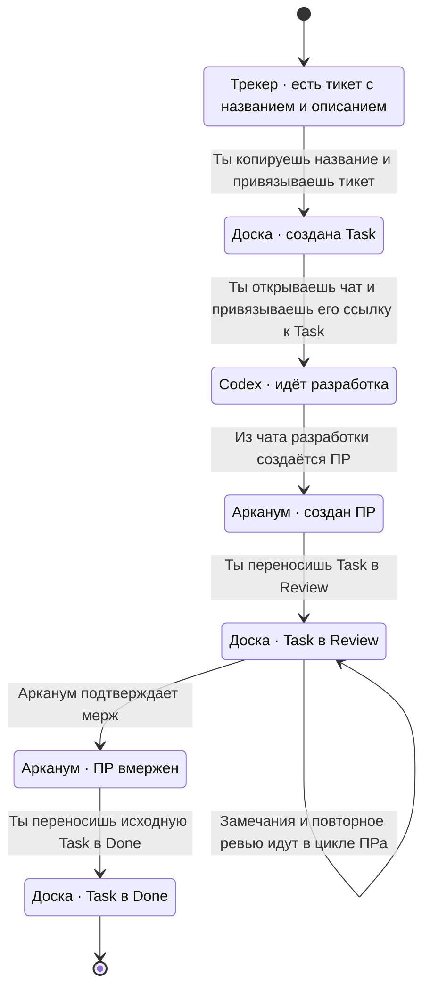
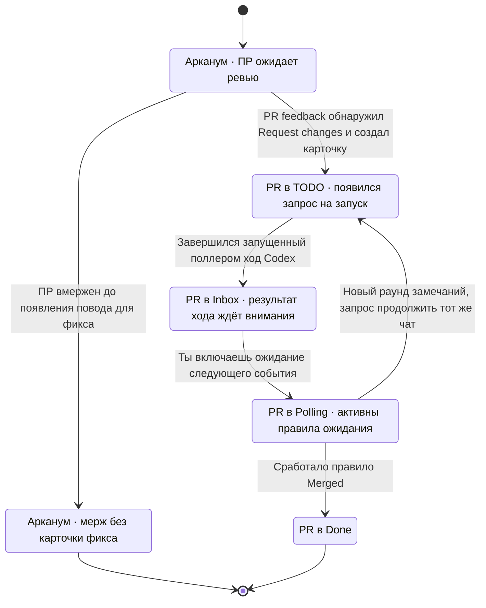

# От тикета в Трекере до Done на доске

Рабочая карта текущего процесса, 13 ноября 2026. Описание владельца доски сверено с историей связанных карточек, ходами Codex и правилами поллинга. Порядок действий внутри одного раунда может меняться. В документе использованы условные имена.

## Задача и чат разработки

Название чата разработки ты задаёшь вручную по шаблону `ПР <TICKET> <ПРОЕКТ и НАЗВАНИЕ>`. Этот чат остаётся на Task, даже когда появляется чат фикса. Черновик ПРа может появиться раньше, чем его отправят ревьюеру. При нескольких ПРах у одной Task решение о её завершении остаётся за тобой.

## Один ПР и его чат исправлений

Пока Task в Review, у PR-карточки есть собственный цикл. Общий источник `PR feedback` следит за своими ПРами. При первом подходящем событии он создаёт карточку и организует запуск чата через запрос с сохранённым режимом старта. В четырёх проверенных связках первый запуск требовал подтверждения. Ниже — переходы самой карточки.

**Что в это время происходит в чате.** После подтверждения старта Codex разбирает замечания и предлагает план. Ты отвечаешь «Ок, делай» или уточняешь решение. Codex выполняет согласованные изменения, проверяет их, обновляет ПР и отвечает в тредах. При повторном запросе от поллера тот же чат разбирает новую волну замечаний. Момент публикации виден в Аркануме независимо от колонки доски.

- **Первый раунд.** В проверенных связках доска создавала PR-карточку и запрос запуска автоматически. Ты переименовываешь созданный чат в `Фикс <TICKET> <ПРОЕКТ и НАЗВАНИЕ>` и вручную связываешь PR-карточку с Task. Связь можно добавить и после первого фикса. На доске это отдельная карточка и строка той же карточки под Task.
- **Два решения.** Подтверждение старта и согласование правок в чате происходят отдельно. Карточка уже может быть в Inbox, хотя код ещё предстоит исправить. В Inbox также возвращается завершившийся ошибкой или прерванный ход от поллера. Ход, запущенный вручную в чате, сам колонку не меняет.
- **Следующий раунд.** Перенос в Polling включает правила этого ПРа. При новых замечаниях правило создаёт запрос продолжить существующий чат. После выхода из Polling правила ждут следующего ручного возврата. При включённом правиле мержа переход Polling → Done автоматический.
- **ПР без замечаний.** Если ПР принят сразу и источник не сработал, PR-карточки фикса может вообще не быть. Тогда есть мерж в Аркануме и ручное завершение Task. В истории чатов встречался и промежуточный вариант — первое замечание исправили в чате разработки, отдельный чат появился в следующем раунде.

## Что сейчас приходится связывать и замечать самому

| Момент | Где виден сигнал | Что ты делаешь |
|---|---|---|
| Берёшь задачу | Трекер | Создаёшь Task на доске, переносишь название, вставляешь ссылку на тикет. |
| Начинаешь разработку | Codex и доска | Запускаешь и называешь чат, копируешь его ссылку в Task. |
| Отдаёшь ПР в ревью | Чат разработки и Арканум | Переносишь Task в Review. До первых замечаний отдельная PR-карточка может отсутствовать. |
| Начинается фикс | Запрос запуска, чат фикса и доска | Подтверждаешь запуск, называешь чат, выбираешь родительскую Task. В чате решаешь, какие правки принимать. |
| Нужно снова следить за ПРом | Чат фикса и доска | Обычно после публикации исправлений переносишь PR-карточку в Polling. По истории это бывает и раньше, пока Codex заканчивает работу. |
| Ревью затянулось | Ожидание в Аркануме и твоя память | Сейчас вспоминаешь и идёшь напоминать. Хочешь собрать ПРы, которые не смотрели больше суток, и одним сообщением напомнить о них в общем чате. |
| ПР вмержен | Арканум и, при активном правиле, Done у PR-карточки | Решив, что работа по задаче окончена, переносишь Task в Done. Статус тикета в Трекере — отдельный вопрос. |

## Как собрать ПРы для напоминания

Первое ожидание начинается в Аркануме с **публикации ПРа**. Через 24 часа со времени публикации открытый ПР, по которому всё ещё ждут ревью, должен попасть в подборку. Когда ревьюер переводит его в `Request changes`, ожидание этого раунда заканчивается, и теперь ход за автором. Вмерженный ПР тоже выбывает. По подборке ты сам пишешь одно сообщение в общий чат.

Для первого ожидания PR-карточка фикса может ещё отсутствовать. Подборке требуется связь с опубликованным ПРом уже на этом этапе. Время переноса Task в Review и время входа карточки фикса в Polling могут отличаться от времени публикации. Для повторного ожидания после исправлений начало нового отсчёта пока открыто.

## Основания и открытые вопросы

В одном подтверждённом примере доска дважды записала возврат PR-карточки из TODO в Inbox и её последующий перенос в Polling. В первом раунде чат показал план в 18:49, карточка вошла в Polling в 19:06, чат подтвердил публикацию в 19:21. В следующем раунде пришли новые замечания. Событие мержа перевело эту карточку в Done. Отдельный перенос Task в Done произошёл через 3 ч 43 мин. В другом примере первый ход фикса завершился до переноса Task в Review, а связь карточек появилась уже после входа PR-карточки в Polling. Журнал перемещений показывает время и колонки. Кто выполняет ручные шаги, известно из описания владельца доски. Названия чатов в истории встречаются и в сокращённой форме.

После первого раунда осталось уточнить, какое событие после фикса начинает новые 24 часа, кто мержит одобренный ПР и когда ты закрываешь тикет в Трекере.

Правила доски и проверенное поведение описаны в [ADR-035](../adr/ADR-035-local-task-board.md) и [проверке типов и связей карточек](task-pr-card-types-validation.md).
